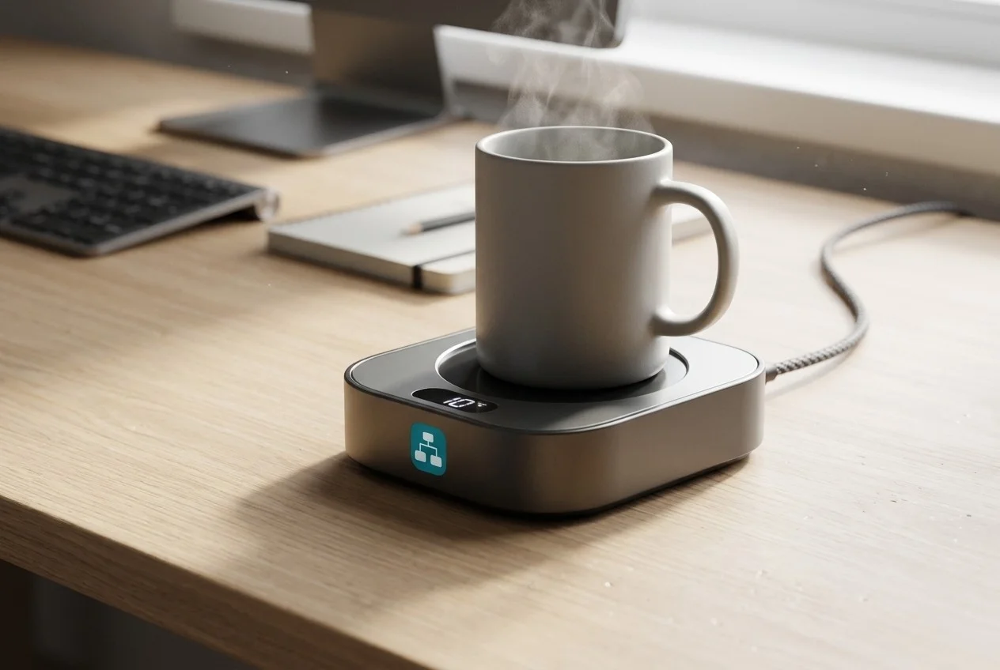

<!--
SPDX-FileCopyrightText: 2026 Elan8
SPDX-License-Identifier: MIT
-->

# Cup warmer (SysML v2)



*Concept illustration, generated with AI. It is not a photograph of a built product.*

A small example that shows [Run42](https://github.com/elan8/run42-release) and
[Doc42](https://github.com/elan8/doc42-release) working on one model. A heated plate keeps a cup warm. A controller,
written as a SysML v2 state machine, warms the plate up, holds its temperature with a thermostat, and an independent
cutout switches the heater off if the thermostat's sensor fails.

```text
model (SysML v2 + Modelica)  ->  run42 verify  ->  build/verdicts.json  ->  doc42 build  ->  verification report (PDF)
```

**Read the report:** the [verification report (PDF)](https://elan8.github.io/sysml-cup-warmer/CW-VR-001.pdf) is rebuilt from the
model and Run42's traces on every push to `main`.

## What is verified

| ID | Requirement | Case |
| --- | --- | --- |
| CW-001 | From 20 degC, the plate under a cup reaches 62 degC within 300 s. | `warmsUp` |
| CW-002 | After warming up, the plate holds the cup between 58 and 67 degC. | `holds` |
| CW-003 | If the control sensor reads 30 K too low, an independent cutout switches the heater off and keeps it off before the plate exceeds 90 degC. | `sensorFault` |

A fourth case checks a rejected alternative, a cheaper 25 W heater, against the same warm-up requirement. It must **fail**: the
script, and with it CI, exits with an error if the alternative passes, because a check that can never fail proves nothing. The
report shows both designs side by side.

The controller has four states: `warming`, `heating` and `resting` (the thermostat band, 60 to 65 degC), and `tripped`, which
latches the heater off. The plate is a Modelica model, [`Warmer.mo`](model/Warmer.mo): heater power, the heat capacity of
plate and cup, and heat loss to the air. The values are assumptions, not measurements.

## Run it

You need [Run42](https://github.com/elan8/run42-release/releases) (Linux x64 for now) and an Elan8 API token for it.

```sh
RUN42=/path/to/run42 bash scripts/verify.sh
```

The three cases take about ten seconds. The script writes `build/verdicts.json` and exits non-zero if a case does not pass.
To build the report, run `doc42 build model --workspace-root . --doc CupWarmerDocuments::report --out generated`;
`doc42 check model --workspace-root .` works without an account. The report needs the Elan8 domain library on the path, as
the [Doc42 documentation](https://elan8.github.io/doc42-release/) describes.

## See a verdict change

The alternative design already shows it: in [`CupWarmer.sysml`](model/CupWarmer.sysml), `LowPowerRig` has a 25 W heater and its
case fails, while the chosen 40 W design passes. Change the 40 W heater power of the plate to 25 W and the chosen design fails
too, because the plate then needs about 460 s to reach 62 degC. To see what the cutout is for, delete the three
`transition cutout...` lines and run the script again: `sensorFault` fails.

## Limits

This is a simulation of a first-estimate model. The verdicts hold for this model and these parameters only. They are not test
results of a real appliance and do not show compliance with any standard.

## License

MIT. See [LICENSE](LICENSE) and [NOTICE.md](NOTICE.md).
